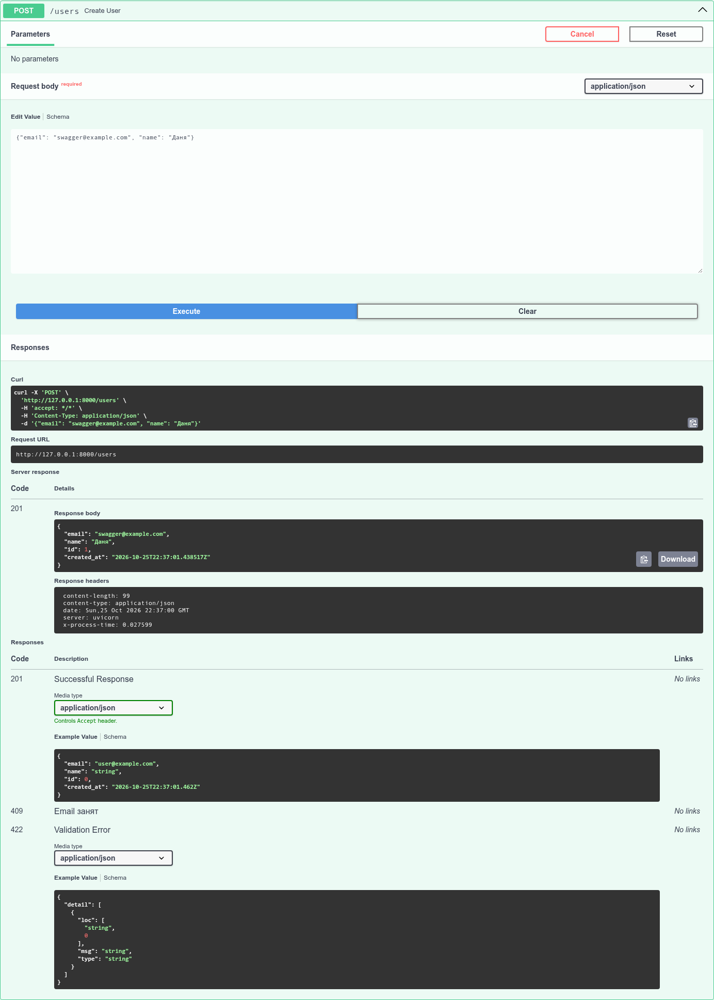
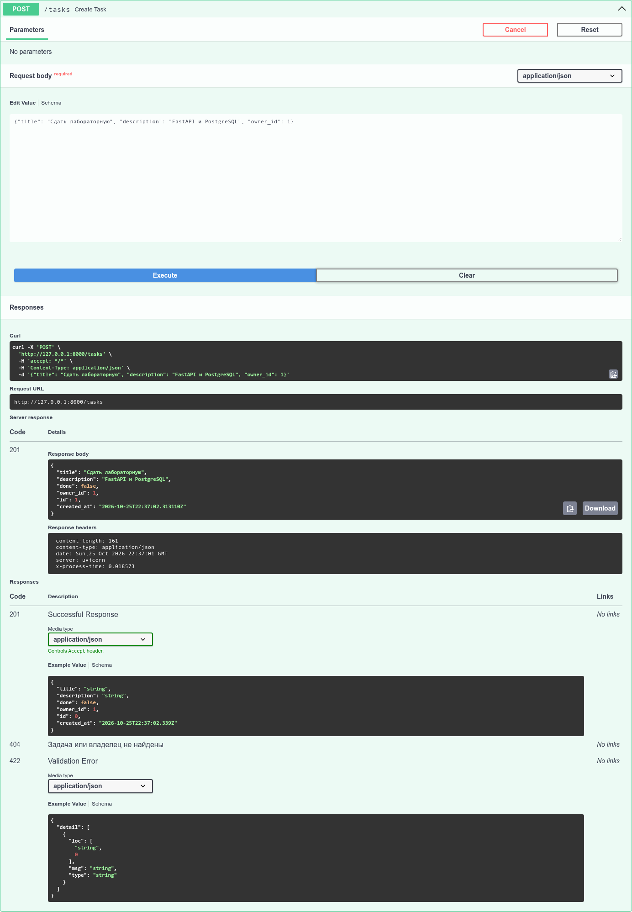
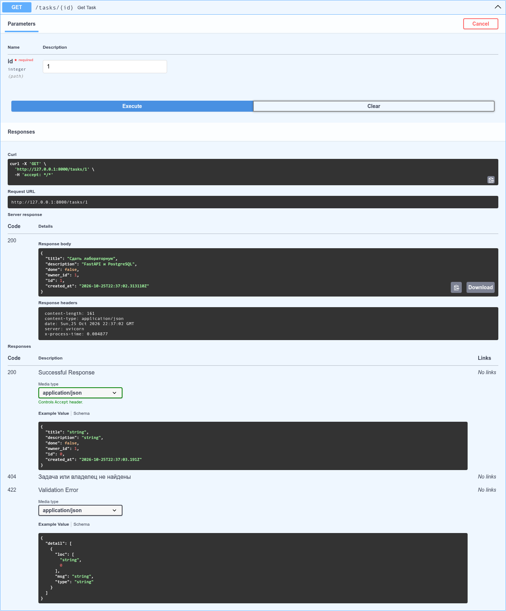
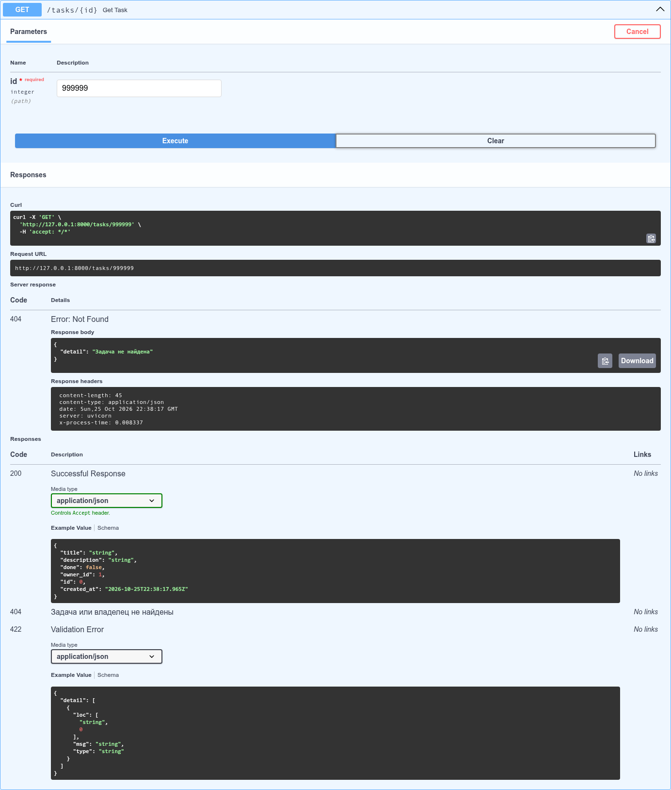
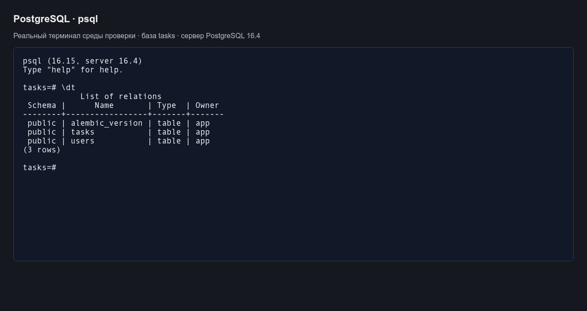

# Практическая работа № 2. REST API «Менеджер задач»

**Задание 6:** разработка REST API на FastAPI с использованием PostgreSQL, SQLAlchemy и Pydantic.

## Цель работы

Разработать веб-сервис для хранения пользователей и их задач. Реализовать асинхронный доступ к PostgreSQL, проверку данных, миграции схемы и middleware для измерения времени обработки запросов.

## Использованные технологии

| Компонент | Назначение |
|---|---|
| Python 3.11+ | Язык разработки |
| FastAPI | Обработчики HTTP-запросов и OpenAPI |
| PostgreSQL 16 | Хранение пользователей и задач |
| SQLAlchemy 2.0, asyncpg | Асинхронный доступ к БД |
| Pydantic v2, pydantic-settings | Валидация и настройки окружения |
| Alembic | Версионирование схемы БД |
| Starlette middleware | Логирование и заголовок времени ответа |
| Docker Compose | Запуск PostgreSQL |
| pytest, pytest-asyncio, HTTPX | Автоматизированные проверки API |

Версии прямых Python-зависимостей зафиксированы в `requirements.txt` и `requirements-dev.txt`.

## Структура проекта

```text
app/
  main.py
  config.py
  db.py
  models.py
  schemas.py
  routers/
    users.py
    tasks.py
migrations/
  env.py
  versions/
    17719f5e4b47_initial_schema.py
tests/
  conftest.py
  test_api.py
docs/
  screenshots/
  evidence/
alembic.ini
docker-compose.yml
requirements.txt
requirements-dev.txt
.env.example
pytest.ini
README.md
```

## Реализация

### Модели данных

| Сущность | Поля |
|---|---|
| User | `id`, уникальный `email`, `name`, `created_at` |
| Task | `id`, `title`, `description`, `done`, `created_at`, `owner_id` |

Связь — один пользователь ко многим задачам. `owner_id` является внешним ключом на `users.id`. Модели объявлены через `Mapped` и `mapped_column`, двусторонняя связь — через `relationship` и `back_populates`.

Название задачи имеет длину от 1 до 200 символов. Описание необязательно, значение `done` по умолчанию — `false`. Даты формируются PostgreSQL, столбцы используют `timestamp with time zone`.

### Настройки, сессии и схемы

Строка `DATABASE_URL` читается через `pydantic-settings` из переменной окружения или локального `.env`. Файл `.env` исключён из Git; пример конфигурации находится в `.env.example`.

Созданы асинхронный движок и фабрика сессий. Обработчики получают сессию через `Depends(get_session)`, зависимость использует `yield` и закрывает сессию после обработки запроса.

Для обеих сущностей предусмотрены схемы Create, Read и Update. В Read включён `from_attributes=True`, email проверяется типом `EmailStr`. Схема `UserUpdate` присутствует согласно требованиям; отдельный маршрут обновления пользователя в обязательное API не входит.

PATCH изменяет только явно переданные поля через `model_dump(exclude_unset=True)`. Передача `description: null` очищает описание. Явный `null` для обязательных столбцов `title`, `done`, `owner_id` отклоняется с кодом 422. Отсутствующие поля не изменяются.

### Миграции

Начальная миграция `17719f5e4b47` получена через Alembic `--autogenerate` и создаёт таблицы `users`, `tasks`, уникальность email, внешний ключ и индекс владельца. Таблицы не создаются через `create_all`. Проверены применение миграции на пустой БД, откат на отдельной тестовой БД и повторное применение. `alembic check` не выявил расхождений между моделями и схемой.

### Middleware

Middleware добавляет заголовок `X-Process-Time` с длительностью обработки в секундах. В лог записываются HTTP-метод, путь, статус и время. Например, при локальной проверке создания задачи получен заголовок `x-process-time: 0.031100`.

## Реализованные эндпоинты

| Метод | Путь | Назначение | Коды ответа |
|---|---|---|---|
| POST | `/users` | Создать пользователя | 201, 409, 422 |
| GET | `/users/{id}` | Получить пользователя | 200, 404 |
| POST | `/tasks` | Создать задачу | 201, 404, 422 |
| GET | `/tasks` | Получить список задач | 200, 422 |
| GET | `/tasks/{id}` | Получить задачу | 200, 404 |
| PATCH | `/tasks/{id}` | Частично обновить задачу | 200, 404, 422 |
| DELETE | `/tasks/{id}` | Удалить задачу | 204, 404 |

В списке задач поддерживаются фильтры `done`, `owner_id` и пагинация: `limit` от 1 до 100, `offset` от 0. По умолчанию `limit=20`, `offset=0`. Результат сортируется по ID.

Пример фильтра: `GET /tasks?done=false&owner_id=5&limit=10&offset=0`. Отсутствующий пользователь или задача возвращают 404, повторный email — 409, неверные поля или параметры — 422. Успешное удаление возвращает 204 без тела ответа.

## Запуск

Требования: Python 3.11+, Docker Desktop с Linux-контейнерами, Docker Compose. Команды PowerShell из корня репозитория:

```powershell
py -3 -m venv .venv
.\.venv\Scripts\python.exe -m pip install -r requirements.txt
Copy-Item .env.example .env
docker compose up -d db
docker compose exec db psql -U app -d tasks -c "select 1"
.\.venv\Scripts\python.exe -m alembic upgrade head
.\.venv\Scripts\python.exe -m uvicorn app.main:app --reload
```

Команда проверки БД выполняется после готовности контейнера. Swagger UI: <http://127.0.0.1:8000/docs>. OpenAPI: <http://127.0.0.1:8000/openapi.json>.

PostgreSQL опубликован на `127.0.0.1:5433`, внутри контейнера — порт 5432. Это исключает конфликт со стандартным портом PostgreSQL, установленного непосредственно в Windows. Учётные данные `app:app` предназначены только для локальной учебной среды.

## Результаты проверки

### Локальный запуск на Windows

При проверке на Windows 11 PostgreSQL 16.15 запущен через Docker Compose. Контейнер перешёл в состояние `healthy`, запрос `select 1` вернул `1`, миграция применена. FastAPI запущен через Uvicorn; `/docs` и `/openapi.json` вернули 200.

| Проверка | Наблюдаемый результат |
|---|---|
| Запуск PostgreSQL через Compose | `healthy`, порт `127.0.0.1:5433` |
| Проверка соединения | `select 1` → `1` |
| Проверка схемы | `No new upgrade operations detected` |
| Создание пользователя | 201; `id=5`, `email=danya.lab6.3@example.com` |
| Повторный email | 409; `Email уже зарегистрирован` |
| Создание задачи | 201; `id=1`, `owner_id=5`, `done=false` |
| Заголовок времени | `X-Process-Time` присутствует |

### Автоматизированная проверка

В отдельной Linux-среде с Python 3.13.15 и PostgreSQL 16.4 выполнены 24 теста. PostgreSQL в этой среде запускался непосредственно, без Docker. Тесты обращались к настоящей БД, SQLite и моки БД не использовались.

| Группа проверок | Результат |
|---|---|
| Создание и получение пользователей, уникальность email | Пройдено |
| Создание и получение задач | Пройдено |
| Фильтры по владельцу и статусу, пагинация | Пройдено |
| Частичное обновление, смена владельца, очистка описания | Пройдено |
| Удаление и отсутствие тела ответа 204 | Пройдено |
| Ошибки 404, 409, 422 | Пройдено |
| Заголовок времени и документация OpenAPI | Пройдено |
| Итог | **24 passed** |

[Вывод pytest](evidence/pytest.txt) · [Проверка миграций](evidence/migrations.txt) · [Проверка соответствия схемы](evidence/alembic-check.txt)

Для повторения автоматизированных тестов используются зависимости `requirements-dev.txt` и отдельная база с именем, заканчивающимся на `_test`. Тесты очищают таблицы и требуют явного разрешения `ALLOW_TEST_DB_RESET=1`; использовать рабочую БД с нужными данными нельзя.

## Скриншоты

Ниже приведены реальные запросы Swagger UI и сеанс psql из отдельной среды автоматизированной проверки (PostgreSQL 16.4). ID и email в скриншотах относятся к этой базе и могут отличаться от результатов локального запуска на Windows.

### POST /users — 201



### POST /tasks — 201



### GET /tasks/1 — 200



### GET /tasks/999999 — 404



### Таблицы PostgreSQL — команда \dt



[Текстовый вывод psql](evidence/psql-tables.txt). Присутствуют таблицы `users`, `tasks` и служебная таблица `alembic_version`.

Команда для БД в Docker:

```powershell
docker compose exec db psql -U app -d tasks -c '\dt'
```

## Контрольные вопросы

### 1. Чем FastAPI отличается от Starlette и какие его компоненты использует?

Starlette — ASGI-фреймворк с маршрутизацией, HTTP-запросами и ответами, middleware, WebSocket, обработкой исключений и lifecycle. FastAPI построен поверх Starlette и добавляет декларативную валидацию и сериализацию через Pydantic, систему зависимостей, генерацию OpenAPI и документацию Swagger UI/ReDoc. В этом проекте используются механизмы запросов и ответов, HTTP middleware, lifespan и обработка HTTP-исключений Starlette.

### 2. Зачем разделять Create, Read и Update?

При создании клиент передаёт данные, необходимые для новой записи; ID и дата создаются сервером. Read описывает публичный ответ с серверными полями. Update разрешает частичную передачу полей, поэтому его нельзя подменять Create: иначе при PATCH понадобились бы все обязательные поля. Разделение также не позволяет случайно открыть клиенту изменение служебных полей.

### 3. Что делает `from_attributes=True`?

Разрешает Pydantic получать значения из атрибутов объекта, а не только из словаря. Поэтому ORM-объект SQLAlchemy можно преобразовать в схему Read и сериализовать в JSON. Настройка не выполняет SQL-запросы и сама не загружает ленивые отношения; необходимые данные должны быть доступны при сериализации.

### 4. Почему сессия передаётся через Depends, а не создаётся глобально?

AsyncSession содержит изменяемое состояние транзакции и не предназначена для совместного использования независимыми конкурентными запросами. Зависимость создаёт сессию на запрос и закрывает её через контекстный менеджер после обработки. Её можно подменить в тестах. Движок и фабрика сессий могут быть общими, но конкретная сессия — нет.

### 5. Чем `exclude_unset=True` отличается от `exclude_none=True`?

`exclude_unset=True` исключает поля, которые клиент не передавал. Явно переданный `null` остаётся, поэтому `{"description": null}` позволяет очистить описание. `exclude_none=True` исключает все поля со значением None независимо от того, передал ли их клиент. Для частичного обновления здесь применяется `model_dump(exclude_unset=True)`. `false` и нулевые значения не нужно отбрасывать по проверке истинности.

### 6. Почему в production таблицы не создают через `create_all`?

`create_all` может создавать отсутствующие таблицы, но не заменяет последовательные изменения существующей схемы и миграцию данных. Миграции Alembic версионируются, просматриваются и применяются контролируемым шагом развёртывания. Это позволяет согласовать код и схему. Автогенерацию нужно проверять вручную, а откат не гарантирует сохранения данных после разрушительных изменений.

## Вывод

Разработан REST API «Менеджер задач» с хранением данных в PostgreSQL, асинхронными сессиями SQLAlchemy, валидацией Pydantic и миграциями Alembic. Реализованы обязательные маршруты, фильтры, пагинация, обработка ошибок и измерение времени запросов. Автоматизированные проверки подтвердили работу API; запуск PostgreSQL в Docker Compose и создание записей подтверждены локально на Windows.

Приложение учебное: аутентификация и разграничение доступа не реализованы. `owner_id` задаёт связь данных, а не проверку прав. Для production необходимы управление секретами, авторизация и отдельная конфигурация развёртывания. Swagger UI по умолчанию загружает ресурсы с внешнего CDN.
